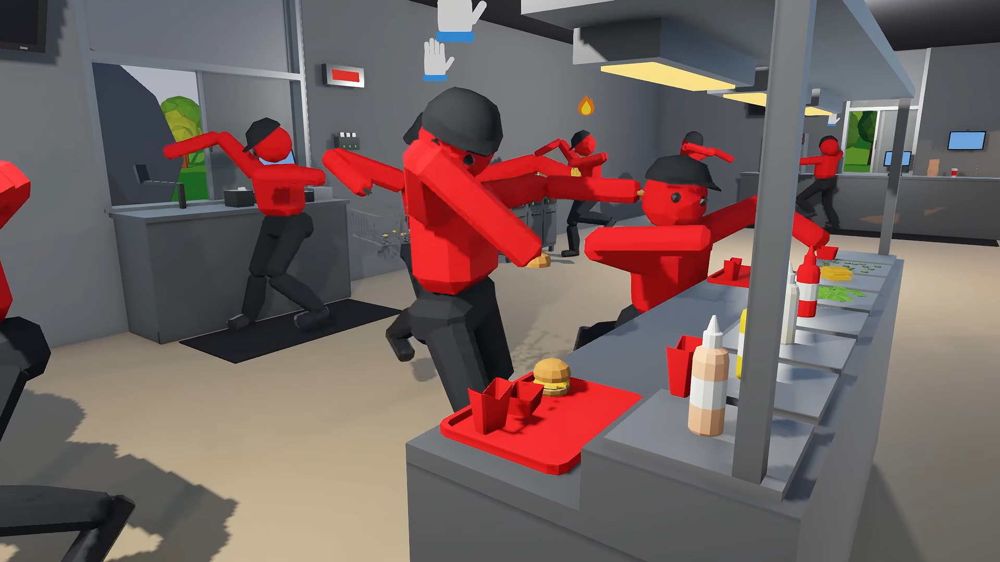
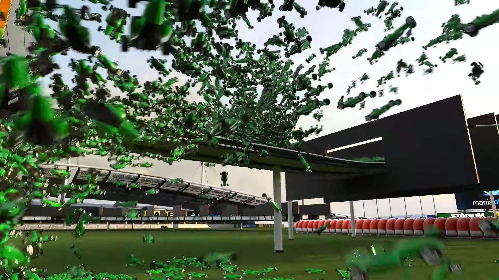
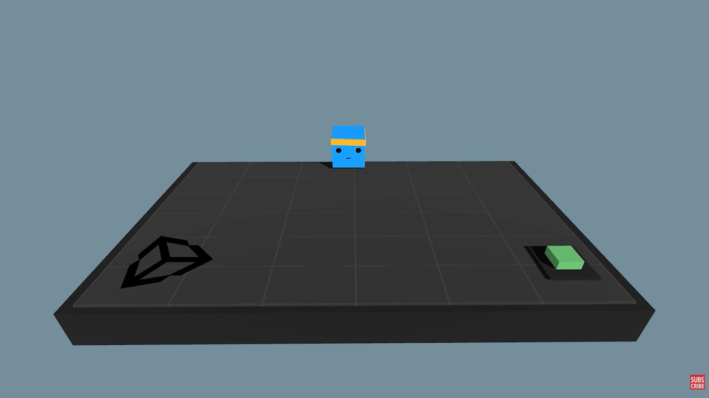
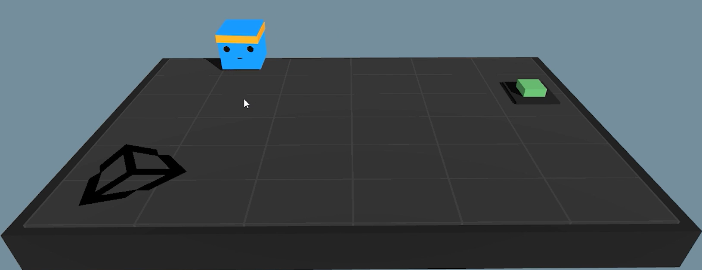
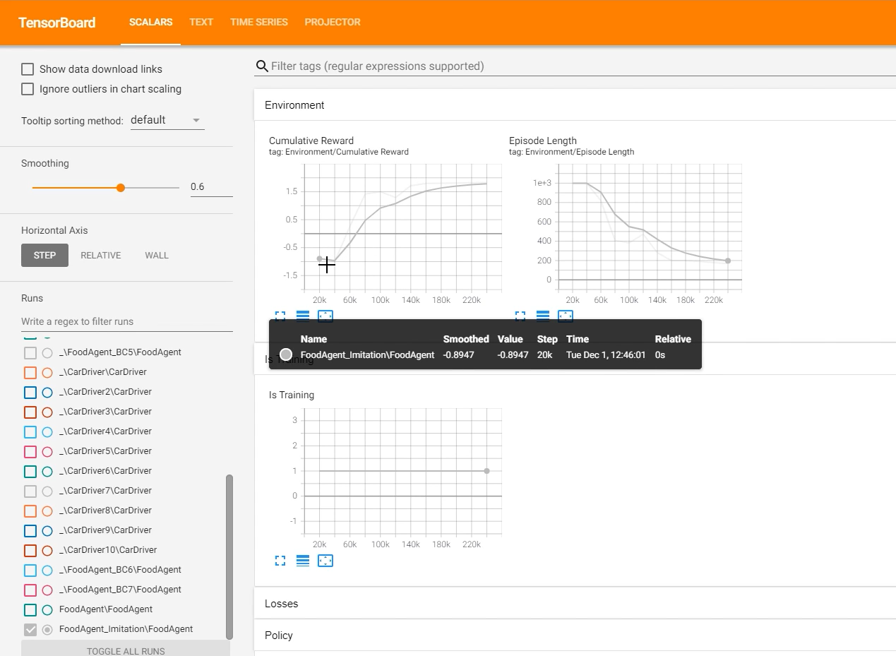
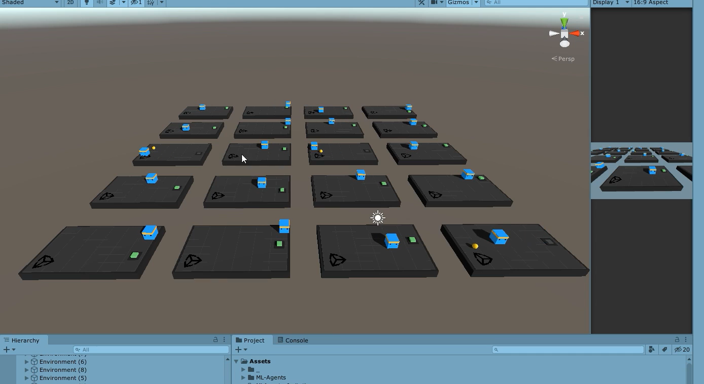

# FICHE 0 - Projet INSPIRANT :

---

## Les 10 URLS :

1. **_AI Learns to Walk (deep reinforcement learning)_** - [LIEN](https://www.youtube.com/watch?v=L_4BPjLBF4E)
2. **_Can AI Run McDonalds?_** - [LIEN](https://www.youtube.com/watch?v=udsdVliG-1M)
3. **_I Forced AI To Learn 4D_** - [LIEN](https://www.youtube.com/watch?v=1BDYSxsVMAE)
4. **_2,351,672 Attempts to Beat One World Record_** - [LIEN](https://www.youtube.com/watch?v=nF4FxCTq6-Y)
5. **_AI Learns to Race Hurdles (deep reinforcement learning)_** - [LIEN](https://www.youtube.com/watch?v=MrbizZybHi4)
6. **_Teach your AI! Imitation Learning with Unity ML-Agents!_** - [LIEN](https://www.youtube.com/watch?v=supqT7kqpEI&t=52s)
7. **_I Forced 4 AIs to Work Together While Being Chained...(it was bad)_** - [LIEN](https://www.youtube.com/watch?v=gQRLoGWaK4k)
8. **_I let AI play Minecraft One Block_** - [LIEN](https://www.youtube.com/watch?v=RQqqm7qk8bk)
9. **_AI Simulates Civilization in Minecraft_** - [LIEN](https://www.youtube.com/watch?v=OSGSROIs8cI)
10. **_10 AIs Play Mafia_** - [LIEN](https://www.youtube.com/watch?v=JhBtg-lyKdo)

---

## Les 3 projets inspirants :

### 1. Projet inspirant :

- **Nom du projet :** Can AI Run McDonalds? (b2studios, 2026)

- **URL du projet :** https://www.youtube.com/watch?v=udsdVliG-1M

- **Sources de données :** Aucune banque de données externe. L'environnement est entièrement simulé (restaurant dans un moteur de jeu). Les données sont générées par la simulation : commandes aléatoires (sur place ou service à l'auto), cibles de mains aléatoires, poussées aléatoires pour déstabiliser l'agent, et une bibliothèque de poses de chute capturées par l'auteur pour entraîner la récupération. Pas de data augmentation au sens classique, mais de la randomisation de l'environnement et de la gravité réduite au début de l'entraînement.

- **Image :** 

- **Résumé :** Des agents « ragdoll » (personnages physiques simulés) tentent de faire fonctionner un restaurant de restauration rapide. Chaque agent est contrôlé par un réseau de neurones entraîné par apprentissage par renforcement (PPO avec bonus d'entropie) sur une bibliothèque de réseaux de neurones maison calculée sur GPU. Deux politiques se partagent le contrôle : une IA de marche, récompensée pour ne pas tomber, avancer vers une cible, alterner les pas et garder les mains près de cibles, et une IA de récupération, récompensée selon la hauteur du bassin. Le système bascule de l'une à l'autre selon la hauteur du bassin. Un graphe de navigation avec recherche de chemin guide les déplacements, et une architecture de tableau noir (blackboard), de l'IA symbolique, répartit les tâches des commandes entre les agents. Après environ 12 h de simulation : 120 commandes livrées (~13 min par commande), 17 commandes non assemblées et ~24 % des aliments brûlés. L'auteur conclut que l'IA ne peut pas vraiment gérer un McDonald's.

- **Caractériser le projet (estimés) :**

| Niveau de difficulté                                                                                                                                            | Temps de la réalisation                                | Temps d'entraînement                                                       |
| --------------------------------------------------------------------------------------------------------------------------------------------------------------- | ------------------------------------------------------ | -------------------------------------------------------------------------- |
| Avancé : bibliothèque de réseaux de neurones maison sur GPU, apprentissage par renforcement avec physique, deux politiques combinées, coordination multi-agents | Plusieurs semaines (estimé, non précisé dans la vidéo) | ~8 h (marche) + ~3 h (récupération), puis ~12 h de simulation pour évaluer |

---

### 2. Projet inspirant :

- Nom du projet : 2,351,672 Attempts to Beat One World Record (Yosh, 2026) : IA de Trackmania sur la piste A12
- URL du projet : https://www.youtube.com/watch?v=nF4FxCTq6-Y
- Sources de données :
  - IA de Trackmania par apprentissage par renforcement : https://github.com/Linesight-RL/linesight
  - Documentation du code : https://linesight-rl.github.io/linesight/build/html/ ET https://linesight-rl.github.io/linesight/build/html/
  - Aucune banque de données externe. L'IA génère ses propres données en jouant au jeu Trackmania (simulation). S'y ajoutent les 100 meilleurs runs humains sur A12, utilisés pour définir un « couloir » de guidage (la vidéo ne dit pas d'où ils viennent).
- Image : 
- Résumé : Yosh entraîne une intelligence artificielle à battre un record du monde sur la piste A12 du jeu Trackmania en utilisant l'apprentissage par renforcement (Reinforcement Learning). L'IA apprend à conduire en effectuant des millions de tentatives et en recevant des récompenses selon sa progression sur le circuit. Pour l'aider à découvrir des raccourcis très difficiles, Yosh utilise les trajectoires des 100 meilleurs joueurs humains afin de guider son apprentissage. L'IA utilise un réseau neuronal pour analyser l'état du jeu et choisir les meilleures actions, tout en explorant différentes possibilités grâce à des perturbations aléatoires. Après plus de 2,3 millions de tentatives et plusieurs heures d'entraînement, elle réussit finalement à battre le record avec un temps de 10,36 secondes, en découvrant et en exploitant des techniques de conduite et des bugs physiques du jeu.

- Caractériser le projet (estimés) :

| Niveau de difficulté                                                                                                                                  | Temps de la réalisation                                                                                                        | Temps d'entraînement                                                                                                          |
| ----------------------------------------------------------------------------------------------------------------------------------------------------- | ------------------------------------------------------------------------------------------------------------------------------ | ----------------------------------------------------------------------------------------------------------------------------- |
| Expert : apprentissage par renforcement sur un jeu à physique complexe, guidage par runs humains, exploration forcée, IA développée depuis des années | Plusieurs années de développement de l'IA (selon l'auteur) ; durée propre au projet A12 non précisée (estimé : plusieurs mois) | ≥ 200 h pour le premier run < 12 s, puis plusieurs heures de plus (durée totale non précisée) ; 2 351 672 tentatives au total |

---

### 3. Projet inspirant :

#### RÉSUMÉ :

- Nom du projet : Teach your AI! Imitation Learning with Unity ML-Agents
- URL du projet : https://www.youtube.com/watch?v=supqT7kqpEI&t=52s
- Sources de données : Démonstrations de gameplay réalisées manuellement par un joueur humain dans un environnement 3D simulé avec Unity. Les observations et les actions du joueur sont enregistrées dans des fichiers .demo.
- Image : 
- Résumé : Ce projet consiste à entraîner une intelligence artificielle à réaliser une tâche complexe dans un jeu 3D en utilisant l'apprentissage par imitation (Imitation Learning) avec Unity ML-Agents.

Contrairement à l'apprentissage par renforcement classique (Reinforcement Learning), où l'agent apprend principalement en essayant différentes actions et en recevant des récompenses, l'apprentissage par imitation lui permet d'observer les actions d'un joueur humain et de reproduire son comportement.

Le joueur contrôle un personnage dans un environnement Unity. Il doit d'abord se déplacer vers un bouton, appuyer dessus pour faire apparaître une nourriture, puis se déplacer vers cette nourriture pour la récupérer.

Grâce au composant Demonstration Recorder, les observations de l'environnement et les actions effectuées par le joueur sont enregistrées. Ces démonstrations servent ensuite de données d'entraînement.

Le projet utilise deux techniques d'apprentissage par imitation :

- Behavioral Cloning (BC) : l'agent apprend à reproduire directement les actions du joueur humain.
- Generative Adversarial Imitation Learning (GAIL) : un discriminateur essaie de distinguer les actions du joueur de celles de l'agent. L'agent apprend progressivement à produire des comportements ressemblant aux démonstrations.
  Ces techniques peuvent être combinées avec le Reinforcement Learning et les récompenses extrinsèques afin que l'agent puisse éventuellement dépasser les performances des démonstrations humaines.

Le résultat est un agent capable d'accomplir automatiquement la tâche : se diriger vers le bouton, l'activer et aller récupérer la nourriture, sans que le programmeur ait à coder directement chacun de ses déplacements.

- Caractériser le projet (estimés) :

| Niveau de difficulté   | Temps de la réalisation                  | Temps d'entraînement                                                           |
| ---------------------- | ---------------------------------------- | ------------------------------------------------------------------------------ |
| Intermédiaire à avancé | 4 à 8 heures pour reproduire le tutoriel | Quelques minutes à plusieurs heures selon les démonstrations et les paramètres |

#### DONNÉES :

##### Source des données

1. [LIENS] Quelles sont les sources de données ?
   - Source principale : environnement de simulation 3D créé dans Unity.
   - Aucune banque de données externe comme Kaggle ou Hugging Face n'est utilisée.
   - Les données sont générées par les interactions d'un joueur humain avec l'environnement.
   - Le joueur effectue plusieurs démonstrations du comportement attendu : déplacement vers le bouton, activation du bouton et déplacement vers la nourriture.
   - Le composant Demonstration Recorder de Unity ML-Agents enregistre les observations et les actions du joueur.
   - Les fichiers de démonstration sont enregistrés au format .demo.
   - Le nombre exact d'échantillons et de démonstrations n'est pas précisé dans la vidéo.
   - Liens utiles :
     - Vidéo originale : Code Monkey, Teach your AI! Imitation Learning with Unity ML-Agents.
     - Documentation Unity ML-Agents : https://github.com/Unity-Technologies/ml-agents
     - Documentation des démonstrations : https://github.com/Unity-Technologies/ml-agents/blob/develop/docs/Training-Imitation-Learning.md

2. [LIENS] Est-ce qu'il y a du Data augmentation ?
   Il n'y a pas de Data Augmentation classique comme dans le traitement d'images (rotation, retournement ou ajout de bruit). Cependant, le projet utilise une randomisation de l'environnement :
   - La position initiale du personnage est randomisée.
   - La position du bouton est randomisée.
   - L'environnement est réinitialisé entre les épisodes. Cette méthode permet à l'agent de ne pas apprendre uniquement une séquence de déplacements correspondant à une position fixe.

   Lien vers le code : Script FoodAgent.cs, notamment la fonction OnEpisodeBegin().)

##### Préparation

1. FORMAT Informatique :
   - Environnement : scène 3D Unity.
   - Format des données d'entraînement : fichiers de démonstration .demo.
   - Ces fichiers contiennent les observations de l'agent et les actions réalisées pendant les démonstrations.
   - Les configurations d'entraînement sont enregistrées dans un fichier YAML (foodagen.yaml).
   - Le script de contrôle de l'agent est écrit en C#.
   - Aucun fichier JPEG, PNG ou CSV n'est utilisé comme dataset principal.

2. FORMAT Mathématique :
   - Les observations sont représentées par un vecteur de 6 valeurs flottantes (float) :
     1. État du bouton : 1 s'il peut être utilisé, 0 sinon.
     2. Direction vers le bouton.
     3. État de la nourriture : 1 si elle est apparue, 0 sinon.
     4. Direction vers la nourriture si elle existe.
     5. et 6. Valeurs restantes correspondant aux composantes des vecteurs de direction.

   - Le vecteur d'observation est donc de taille :
     - (6,) — six valeurs numériques de type float.

   - Les actions sont représentées par des actions discrètes :
     - Ne pas bouger.
     - Aller à gauche.
     - Aller à droite.
     - Aller vers l'avant.
     - Aller vers l'arrière.
     - Utiliser le bouton.

   - Il n'y a pas de reshape d'image puisque le réseau travaille sur des observations numériques de l'environnement et non sur des images.

3. FORMAT d'Intelligence :
   - Les annotations sont remplacées par des démonstrations comportementales enregistrées au format .demo.
   - Chaque démonstration contient notamment :
     - Les observations de l'environnement.
     - Les actions réalisées par le joueur.
     - Les étapes de chaque épisode.
     - Les récompenses obtenues.
   - Il ne s'agit donc pas d'annotations YOLO, COCO ou de dossiers contenant des images classées. Les étiquettes comportementales proviennent directement des actions humaines enregistrées.

   - Lien vers le format des démonstrations : https://github.com/Unity-Technologies/ml-agents/blob/develop/docs/Training-Imitation-Learning.md

#### ALGORITHME :

1. Langages, librairies et run-time utilisés
   - Langage et environnement d'entraînement : Python, avec le toolkit Unity ML-Agents et son système d'entraînement. Le fichier de configuration est en YAML.

   - Langage et environnement d'affichage / exécution : C# dans Unity. Le personnage, les déplacements, les boutons et l'environnement 3D sont contrôlés par des scripts C#.

   - Librairies d'IA et de calcul mathématique : Unity ML-Agents, qui fournit les algorithmes Behavioral Cloning (BC), GAIL et Reinforcement Learning.

   - Librairies graphiques, de formats ou de connectivité : Unity Engine pour la simulation et la visualisation 3D ; TensorBoard pour visualiser les courbes d'entraînement.

   - Run-time et matériel utilisé : Unity Editor pour exécuter la simulation, Python pour entraîner l'agent et TensorBoard pour suivre les résultats. L'entraînement peut être effectué sur plusieurs instances de l'environnement simultanément. Le système d'exploitation et le modèle de GPU utilisés ne sont pas précisés dans la vidéo.

2. Algorithme utilisé et type
   - Famille et type d'algorithme : Apprentissage par imitation (Imitation Learning), combinant Behavioral Cloning (BC) et Generative Adversarial Imitation Learning (GAIL), avec apprentissage par renforcement (RL).

   - Tâche réalisée : Apprentissage du comportement d'un personnage dans un environnement 3D. L'agent doit apprendre à se déplacer jusqu'à un bouton, l'activer pour faire apparaître un objet de nourriture, puis aller récupérer cet objet.

   - Lien direct vers le code de l'algorithme dans le projet inspirant :
     - Dépôt officiel Unity ML-Agents sur GitHub
     - Documentation officielle sur l'apprentissage par imitation
     - Configuration de l'entraînement
   - Fonctionnement des algorithmes :
     1. Behavioral Cloning (BC) : l'agent reçoit les observations et les actions enregistrées dans les démonstrations humaines. Il apprend à reproduire les actions du joueur. C'est similaire à un apprentissage supervisé.

     2. GAIL (Generative Adversarial Imitation Learning) : un deuxième réseau neuronal appelé discriminateur apprend à reconnaître si un comportement provient d'une démonstration humaine ou de l'agent. L'agent cherche à produire des comportements suffisamment semblables aux démonstrations pour tromper le discriminateur.

     3. Reinforcement Learning (RL) : l'agent reçoit également des récompenses lorsqu'il accomplit les objectifs. Cela lui permet d'améliorer son comportement au-delà de la simple reproduction des démonstrations.
     - Les trois approches peuvent être combinées pour obtenir un comportement plus performant

3. Structure et paramètres
   - Couche d'entrée / représentation du génome :
     - Aucune image n'est utilisée en entrée.
     - L'agent reçoit un vecteur de 6 valeurs flottantes (float).
     - Ces valeurs représentent l'état du bouton, la direction vers le bouton, l'état de la nourriture et la direction vers celle-ci.
     - Les données sont donc des observations numériques de l'environnement.

   - Couches cachées (Conv2D, kernels, pooling) / opérateurs de sélection et croisement :
     - Le projet utilise un modèle d'apprentissage neuronal fourni par Unity ML-Agents.
     - Il n'y a pas de couches convolutives Conv2D ou de MaxPooling, puisque l'agent ne traite pas d'images.
     - Le réseau apprend à associer les observations aux actions à effectuer.
     - GAIL utilise également un réseau discriminateur pour comparer les comportements de l'agent et ceux des démonstrations.
     - Le nombre exact de couches cachées et de neurones n'est pas indiqué dans la vidéo.

   - Couche de sortie / fonction d'évaluation (fitness ou loss) :
     - La sortie correspond aux actions discrètes que l'agent peut effectuer.
     - Déplacements : gauche, droite, avant, arrière ou immobile.
     - Une action supplémentaire permet d'utiliser le bouton.
     - Récompense positive lorsque le personnage active le bouton.
     - Récompense positive lorsqu'il récupère la nourriture.
     - Récompense négative à chaque action pendant la phase d'optimisation, afin d'encourager l'agent à terminer la tâche rapidement.

   - Hyperparamètres clés (learning rate, epochs, batch size, taille de population, mutation) :
     - Force de Behavioral Cloning (strength) : 0.5 dans la démonstration.
     - Force de GAIL (strength) : 0.5 dans la démonstration.
     - Chemin vers les démonstrations : paramètre demo_path.
     - Récompenses extrinsèques : utilisées pour encourager la réussite de la tâche.
     - Le créateur explique qu'il est possible de diminuer les forces de BC et GAIL à environ 0.1 après l'apprentissage initial, afin de donner davantage d'importance aux récompenses.
     - Le learning rate, le batch size, le nombre d'époques et le nombre total de steps ne sont pas précisés dans la vidéo.

4. Extrait de code de l'architecture

   ```yaml
   reward_signals:
     gail:
       strength: 0.5
       demo_path: demos/food agent demo.demo

   behavioral_cloning:
     strength: 0.5
     demo_path: demos/food agent demo.demo
   ```

   Liens vers les informations techniques :
   - Code source et toolkit ML-Agents
   - Documentation Behavioral Cloning et GAIL
   - Documentation du composant Agent

#### RÉSULTATS :

1. Explications
   - Le résultat principal est un agent intelligent capable de réaliser automatiquement une tâche qui était initialement difficile à apprendre par simple apprentissage par renforcement.
   - Au début, lorsque l'agent utilise uniquement le Reinforcement Learning, il effectue des actions aléatoires. Il a beaucoup de difficulté à accomplir toutes les étapes dans le bon ordre.
   - Après l'ajout des démonstrations humaines et des techniques BC et GAIL, l'apprentissage devient beaucoup plus rapide.
   1. Pendant l'entraînement :
      - Plusieurs agents commencent à apprendre à se déplacer vers le bouton.
      - Ils apprennent ensuite à activer le bouton.
      - Ils apprennent finalement à se diriger vers la nourriture pour la récupérer.
      - Le comportement devient progressivement plus rapide et plus efficace.

   2. Le créateur utilise TensorBoard pour visualiser les résultats de l'entraînement :
      - Reward : la récompense augmente fortement lorsque l'agent commence à réussir la tâche.
      - Episode Length : la durée des épisodes diminue, ce qui indique que l'agent apprend à terminer la tâche plus rapidement.
   - Le modèle final est capable d'accomplir les trois étapes sans intervention humaine. Une deuxième version entraînée plus longtemps se déplace encore plus rapidement et directement vers les objectifs.
   3. Précision atteinte, évolution de la courbe de loss, matrice de confusion, forces et limites observées par l'auteur du projet
      - Précision atteinte : aucune valeur numérique de précision en pourcentage n'est fournie. La réussite est évaluée visuellement par la capacité de l'agent à compléter la tâche.

      - Courbe de loss : aucune valeur précise de loss n'est présentée. Le tutoriel montre plutôt l'évolution des récompenses (Reward) et de la longueur des épisodes (Episode Length).
      - Matrice de confusion : non applicable à cette tâche, car il ne s'agit pas d'un problème de classification.

      - Forces :
        - L'agent apprend plus rapidement grâce aux démonstrations humaines.
        - Il peut apprendre des tâches complexes avec plusieurs actions successives.
        - Il est possible de combiner plusieurs méthodes d'apprentissage.
        - Il peut améliorer les comportements appris grâce aux récompenses.
      - Limites :
        - La qualité des démonstrations influence directement la qualité de l'apprentissage.
        - Des démonstrations insuffisantes ou incorrectes peuvent produire un mauvais comportement.
        - Behavioral Cloning seul ne permet pas nécessairement de dépasser les démonstrations fournies.
        - Il faut ajuster les paramètres de BC, GAIL et des récompenses pour obtenir de bons résultats.

2. Résultats
   - Image 1 : Environnement Unity et personnage contrôlé par l'IA : 
   - Image 2 : Entraînement et évolution des récompenses dans TensorBoard : 
   - Image 3 : Résultat final – l'agent apprend à appuyer sur le bouton et récupérer la nourriture : 
